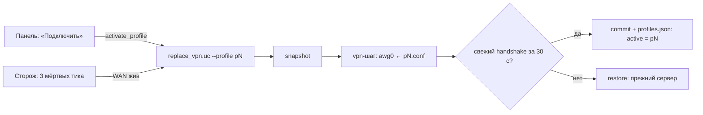

# ADR 0008 — Несколько AWG-серверов: выбор страны и автосмена

> [!info] Статус: принято · владелец хранит до 16 конфигов AmneziaWG (обычно — серверы в разных
> странах), переключается между ними из панели в одно нажатие, а при желании роутер сам переходит
> на следующий сервер, если текущий перестал отвечать.

## Контекст

Один конфиг — одна точка отказа: сервер выключили, сменился IP, провайдер VPN переехал. До сих пор
выход был один — найти файл, открыть «Замену сервера», вставить. Пользователи просили держать
несколько серверов под рукой и переключаться между ними, а один из них собрал это у себя сам
(вместе с Telegram-ботом, бэкапами и прочим). Задача ADR — взять из этого **ядро**, которое
укладывается в принципы проекта, и записать, от чего отказываемся.

## Решение

### Профиль — это сохранённый `.conf`, а не второй туннель

- Интерфейс по-прежнему **один** (`awg0`), здоровье по-прежнему одно. Профиль лишь лежит на флеше:
  `/etc/cheburnet/profiles/pN.conf` (права 600) + `/etc/cheburnet/profiles.json` (имена, порядок,
  активный, флаг автосмены — без секретов).
- Переключение — **тот же** `replace_vpn.uc`, что и ручная замена сервера: снимок → применить →
  ждать рукопожатие → commit или откат. Нового механизма надёжности нет — переиспользуется
  проверенный.
- Активным профиль становится **только после подтверждённого рукопожатия**. Иначе панель и
  автосмена считали бы подключённым то, что откатилось.
- Установка мастером и ручная замена конфига тоже записывают сервер в профили — список
  заполняется сам, без отдельного шага.

### Автосмена — решение сторожа, по умолчанию выключена

Раз в 5 минут сторож уже собирает факты, в том числе «жив ли туннель». Если включена автосмена:

1. туннель мёртв **3 тика подряд** (15 минут — rekey и перезапуск WAN не в счёт);
2. **домашний интернет жив** — ping мимо туннеля (привязка к WAN-интерфейсу). Если интернета нет,
   серверы не перебираются: дело не в них;
3. пробуем следующий сервер **по порядку списка** (порядок = приоритет), по одному за тик;
4. заработал — остаёмся на нём; перебрали всех — молчим и повторяем круг через час.

Каждая смена пишется в журнал (`logread -e cheburnet-watchdog`) и показывается в панели:
«Переключился сам 5 мин назад: сервер «Германия» не отвечал, подключён «Нидерланды»».

> [!warning] Автосмена не лечит закрытый UDP
> Все AWG-серверы ходят по UDP. Если UDP режут целиком, упадут все сразу, и перебор стран не
> поможет — нужен другой транспорт (VLESS+Reality, [[0004-multi-protocol-tiers]]). Перебор спасает,
> когда умер **сервер**, а не **канал**.

## От чего отказались

| Предложение | Почему нет |
|---|---|
| Telegram-бот (управление, уведомления) | Постоянный процесс, токен на роутере, внешний API, новая поверхность атаки — против «минимума поддержки» и «лёгкости». Журнал и панель покрывают «что произошло». |
| Зашифрованный бэкап профилей | Отдельная функция со своей криптографией; вернёмся, если попросят. |
| Пинг/потери до всех серверов | Пинг неактивного сервера ничего не говорит про AWG (UDP-рукопожатие ≠ ICMP); честный признак здоровья — только у подключённого. |
| Имена стран в анонимном `status` | `status` доступен любому в LAN без входа; список стран — только после входа (`list_profiles`). |

## Последствия

- Существующие установки начинают с пустого списка: текущий сервер появится в нём после
  следующей замены конфига (восстанавливать `.conf` из UCI не стали — лишний код ради разового случая).
- Лимит 16 профилей — чтобы список влезал в экран телефона, а полный круг автосмены — в разумное время.
- Тесты: `engine/profiles/tests` (логика и решение автосмены), `engine/watchdog/tests/test_tick.uc`
  (тик целиком в песочнице), `engine/install/tests/test_replace.uc`, `engine/ubus/tests/test_rpcd.uc`.
  На живом роутере не проверено — нужен прогон `make qemu-install` и E2E на железе.
